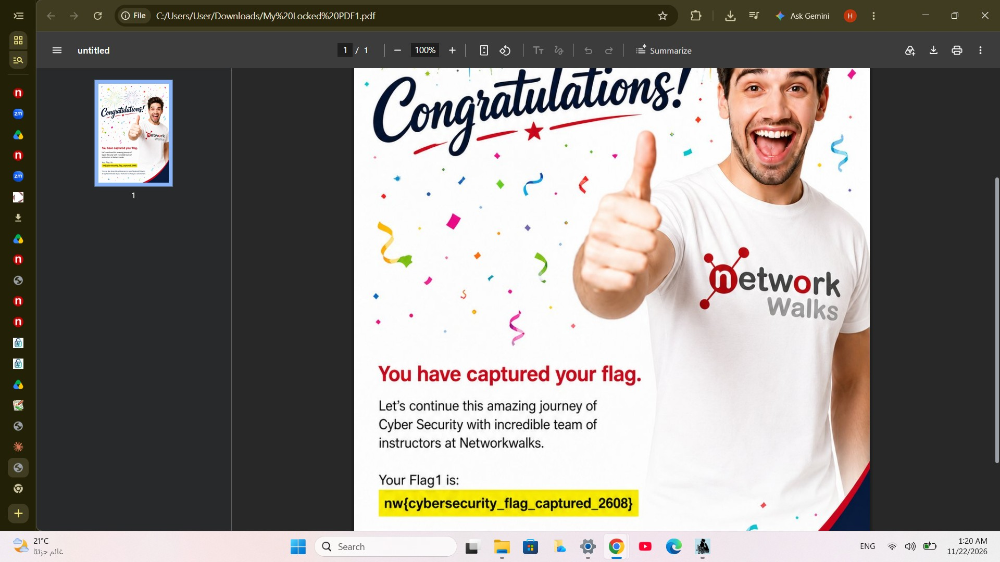
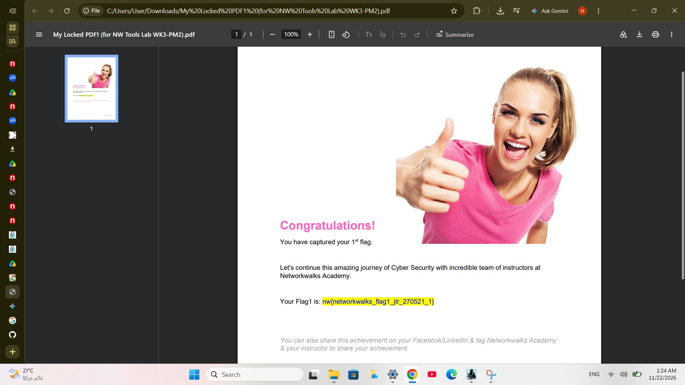

# NetworkWalks-W3-PM1-JTR-Lab
# NetworkWalks Internship - Week 3 Project Module 1

## Lab Overview
Password security auditing and document recovery lab using John the Ripper (JTR).

## Captured Flags & Proof

### Flag 1: `My Locked PDF1.pdf`
* **Captured Flag:** `nw{cybersecurity_flag_captured_2608}`
* **Proof:**

### Flag 2: ``My Locked PDF1 (for NW Tools Lab WK3-PM2).pdf`
* **Captured Flag:** `nw{networkwalks_flag1_jtr_270521_1}`
* **Proof:**

## Key Takeaways & Security Mitigation
* Weak or common dictionary passwords on encrypted files can be recovered offline once a file's hash is extracted.
* Organizations should enforce strong, high-entropy passphrases and modern encryption standards to protect sensitive PDFs and archives.
